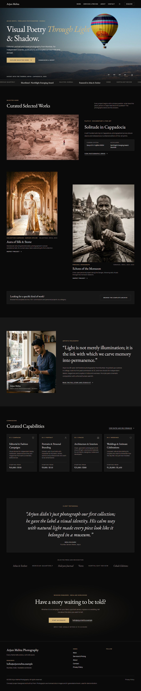
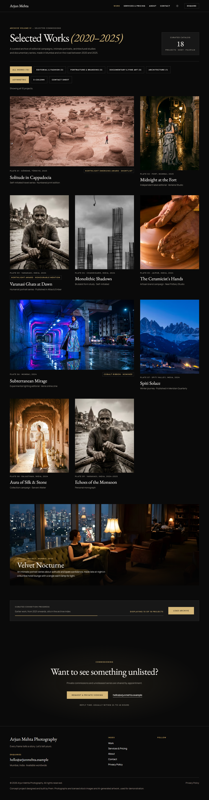
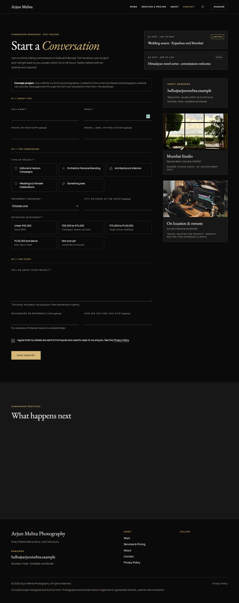
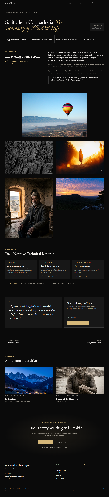
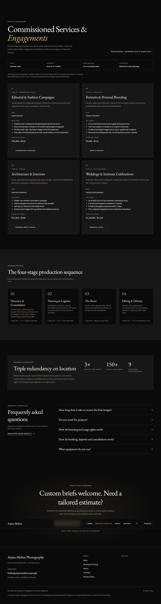
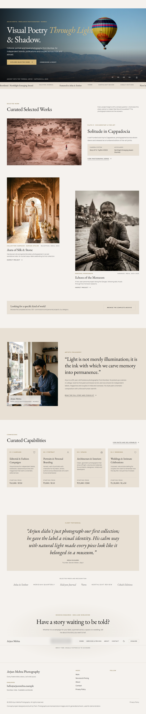

# Arjun Mehta Photography

A concept portfolio website for a fictional Mumbai photographer, designed and built end to end by **Prem**. It turns a detailed design into a fast, accessible, animated website: eight page types, light and dark themes, a working enquiry form and static pre-rendering.

**Live demo:** https://arjun-mehta-photographer.vercel.app/



> **This is a concept project.** Arjun Mehta, his clients, publications, awards and prices are fictional. The photographs are licensed stock images and AI-generated artwork, used for demonstration (see [CREDITS.md](CREDITS.md)). Messages sent through the contact form are received by the developer.

## What this project shows

- **Design to code:** a full multi-page design (typography, colour tokens, light and dark themes) turned into reusable components.
- **Motion with care:** scroll reveals, a hero slideshow, word-by-word headlines, count-up numbers, parallax and magnetic buttons, all switched off for visitors who prefer reduced motion and never hiding content from people without JavaScript.
- **Real working parts:** a validated enquiry form that delivers to a real inbox, a filterable portfolio, an accessible image viewer and a site search on the 404 page.
- **Built to be found:** every page is pre-rendered to static HTML, with unique titles, descriptions, social-share tags, structured data, a sitemap and a robots file.
- **Honest content:** nothing is passed off as real, and the privacy page describes only what the site actually does.

## Features

**Pages**
- Home: four-slide hero, scrolling ticker, featured works, philosophy, capabilities with prices, testimonial and press
- Portfolio: category filters, three layouts (asymmetric, 3-column, contact sheet), a banner project, an archive index with a cursor-following preview
- Project pages: a long-form story layout (essay, captioned plates, field notes, print-edition panel) and a lighter layout
- Services: tier cards, a four-stage process, FAQ accordion
- About, Contact, Privacy, and a custom 404 with a working search

**Experience**
- Light and dark themes with a saved choice and no flash on load
- Entry curtain on the first visit, a header that steps aside while you read, a scroll-progress line and page fades
- Responsive from phones to wide desktops, with a full-screen mobile menu

**Quality**
- Semantic landmarks, a skip link, visible focus, keyboard-friendly controls, labelled forms and live regions for filter and search results
- Responsive AVIF, WebP and JPG images at several sizes, with reserved space so the page never jumps
- Self-hosted fonts, font preloading, long-lived caching for built files
- Built toward WCAG 2.2 AA. It has not been formally audited, so run your own checks before relying on it.

## Screenshots

<p>
  
  
</p>
<p>
  
  
</p>
<p>
  
</p>


## Tech stack

| Tool | What it does here |
| --- | --- |
| React 19 + TypeScript 6 | Components, with typed content so a data mistake is caught early |
| Vite 8 | Dev server and production build |
| React Router 8 (framework mode) | Pages, per-page meta tags and **static pre-rendering** of every route |
| Tailwind CSS 4 | Styling, with light and dark design tokens as CSS variables |
| GSAP + ScrollTrigger | Scroll and intro animation, via `@gsap/react` |
| React Hook Form + Zod | The enquiry form and its validation rules |
| Formspree | Delivers form submissions (free tier: 50 a month) |
| Lucide | Icons |
| Fontsource | Self-hosted fonts (EB Garamond, Manrope, Outfit) |
| sharp | Build-time image processing |
| Vercel | Hosting (static files) |

## Getting started

Requires **Node.js 22.22 or newer**.

```bash
git clone https://github.com/karanpr01/Arjun-Mehta-Photography.git
cd arjun-mehta-photography
npm install
npm run dev
```

Open http://localhost:5173.

## Scripts

| Command | What it does |
| --- | --- |
| `npm run dev` | Start the development server |
| `npm run build` | Build the static site into `build/client` (and create `404.html`) |
| `npm run preview` | Serve the built site locally, the way a static host would |
| `npm run typecheck` | Check the TypeScript types |
| `npm run images` | Create optimised image sizes from `assets/images-src/` |
| `npm run images:check` | Report which required photos are present and large enough |
| `npm run og` | Make the social-share picture from the hero photo |

## Environment variables

Copy `.env.example` to `.env`. `.env` is ignored by Git.

| Variable | What it is |
| --- | --- |
| `VITE_FORMSPREE_FORM_ID` | The code at the end of your Formspree form URL. Leave empty to run the form in demo mode (nothing is sent). |
| `VITE_SITE_URL` | The public address, with no slash at the end. Used for canonical links, share tags and the sitemap. Read at build time. |

Variables starting with `VITE_` are visible to every visitor. Never put a real secret in one.

## How the content works

All content lives in typed files in `app/data/`, so pages are built from data, not from copied text.

| File | Holds |
| --- | --- |
| `site.ts` | Name, contact details, stats, studios, the concept-project credit |
| `projects.ts` | Projects, categories, captions, the long-form story |
| `archive.ts` | Earlier work shown in the Portfolio archive |
| `services.ts`, `process.ts`, `faqs.ts` | Services, working process and FAQ |
| `about.ts`, `home.ts`, `contact.ts` | About page, Home page and Contact page content |
| `privacy.ts` | The privacy policy (must match what the site really does) |

## Photos

1. Put JPG originals in `assets/images-src/`. A file's name (without `.jpg`) is its `id`.
2. `npm run images:check` lists what is missing or too small.
3. `npm run images` creates AVIF, WebP and JPG sizes in `public/images/` and updates `app/data/imageManifest.json`.
4. `npm run og` refreshes the social-share image from `hero.jpg`.
5. Record each photo's source in `CREDITS.md`.

## Project structure

```
app/
├── components/
│   ├── forms/      Enquiry form
│   ├── gallery/    Image components (ResponsiveImage, ProjectCard, Lightbox, filters, archive index)
│   ├── layout/     Header, Footer, MobileMenu, ThemeToggle, SkipLink
│   ├── motion/     Curtain, Words, Reveal, CountUp, Parallax, Magnetic, ScrollProgress
│   ├── sections/   Page sections (Hero, FeaturedWorks, StoryBody, ServiceCard, ...)
│   └── ui/         Small building blocks (Container, ButtonLink, Field, Accordion, ...)
├── data/           Typed content (see above)
├── hooks/          useTheme, useHydrated, useHeaderHidden
├── lib/            SEO helpers, structured data, form schema and submit helper, search
├── routes/         One file per page, plus sitemap.xml and robots.txt
├── styles/         Global CSS and design tokens
├── root.tsx        HTML shell shared by every page
└── routes.ts       URL to page map
assets/images-src/  Original photos (not served directly)
public/             Served as-is (generated images live in public/images/)
scripts/            Image processing, share picture, 404 copy
docs/screenshots/   Images used in this README
```

## Deployment

The site builds to plain static files in `build/client`, so any static host works. It is set up for **Vercel**:

1. Import the repository. `vercel.json` sets the build command, output directory, clean URLs and cache headers.
2. Choose Node.js 22.22 or newer in the project settings.
3. Add `VITE_SITE_URL` (your `.vercel.app` address) and, optionally, `VITE_FORMSPREE_FORM_ID`.
4. Redeploy after changing either variable, because both are read at build time.

Vercel's free Hobby plan is for personal, non-commercial use. A site built for a paying client needs a different plan or host.

## Decisions and limitations

- **Static pre-rendering** instead of a server, for speed, simple hosting and search-engine friendliness. New projects need a rebuild.
- **No cookies, analytics or tracking.** The only thing stored in the browser is the chosen theme.
- **No automated tests** in this project. Before deploying, `npm run typecheck`, `npm run build` and clicking through `npm run preview` are the checks.
- **The entry curtain** adds about two seconds on a first visit. It can be turned off with one line in `app/lib/motion.ts`.
- **Placeholder people and prices.** Everything about Arjun is invented. Replace `app/data/` and the photos to reuse the site for a real photographer.

## Credits and licence

- **Code:** MIT licence (see [LICENSE](LICENSE)).
- **Photographs and artwork:** not covered by the code licence. They are licensed stock photographs and AI-generated images. Sources are listed in [CREDITS.md](CREDITS.md).
- **Design:** implemented from a supplied design concept.

## Built by

**Prem**, self-taught full-stack web developer.

Want a website like this for your own work or business?

- Portfolio: [Link](https://premdev-portfolio.vercel.app/)
- LinkedIn: [Link](https://www.linkedin.com/in/prem-karn-a8707b36a/)
- Email: [Link](mailto:Karanprem01@gmail.com)